# R12-3a 认知资料来源盘点（源码走查）

基线：`4dcafb6ffbcf438fde489399bd19315814dbb267`（当前 HEAD，2026-11-27 盘点）。
本文是**只读源码盘点**：不修改 src/tests/build，不启动应用、不发送消息、不跑构建；所有 file:line 来自 `read`/`grep` 工具对当前 HEAD 的走查。
文档目标：统一 13 类认知资料的**数据源、权威来源、稳定引用、版本/时间语义、归属、隐私投影、使用入口、预算、重复关系**，为 R12-3b 的统一上下文/状态连续性设计与去重提供依据。
凡源码里没有直接证据的，文中标「未确认」，不做补全。

---

## A. 基线与范围

### A1 基线

| 项 | 值 |
|---|---|
| Git HEAD | `4dcafb6ffbcf438fde489399bd19315814dbb267` |
| 项目 | Qt6/C++，SQLite 记忆库（迁移脚本内联在 `memorymanager.cpp`，本次未见 schema v34+） |
| 盘点方式 | 逐文件 read/grep；未运行 ctest、未打开生产库、未启动进程。**行号以 git HEAD 提交内容为准**：盘点期间工作区出现其它切片的未提交改动（`src/cognition/llmservice.*`、新增 `cognitivecontext.*` 等），本文引用未使用这些未提交内容；合并/继续开发后按 diff 复核行号 |
| 关键约束 | 现有实现同时存在 R12-2b/R12-2c 的「提案→核验→提交→Outbox→回执」新链，以及 legacy reflection/reminder/thought 链；本文两者都标注 |

### A2 涉及文件

| 文件 | 作用（本次实际走查） |
|---|---|
| `src/cognition/llmservice.cpp` / `.h` | 前台准备、自动检索、CURRENT_UNDERSTANDING、MEMORY_DATA 注入、回顾生成、consult、工具轮、verifier 链 |
| `src/cognition/promptassembler.cpp` / `.h` | MEMORY_DATA / RECENT_GROUP_CONTEXT / 短期历史 / 身份 / 场景块组装 |
| `src/cognition/cognitivesnapshot.cpp` / `.h` | CognitiveSnapshot 构建、每域统计、预算裁剪、prompt JSON |
| `src/cognition/cognitiveorigin.h` | 回顾来源身份（reflection/concern/thought/activity/wake）稳定引用 |
| `src/cognition/actionorigin.h` | 行动来源身份 + Action Key + VerificationBinding + EvidencePurpose |
| `src/cognition/actionpolicy.cpp` | 证据 ref 读取（chat/source/raw_event/reflection/matter/revision/thought/activity/delivery）、确定性校验、coverage、budget |
| `src/cognition/actioncommitter.cpp` | 行动提交（委托 MemoryManager 事务） |
| `src/memory/memorymanager.cpp` / `.h` | 全部 SQLite 表、快照域查询、matter/理解、OpenWake、活动、outbox/ledger/回执、历史投影 |
| `src/memory/matterstore.cpp` | `historicalReports`、`matterHeads`、`internalMatters`（认识修订来源） |
| `src/memory/privatereflection.cpp` | reflection/concern/reminder 的领取、上下文、提交、reminder 领域函数 |
| `src/memory/memoryevidence.*` / `memoryretrieval.*` | 自动检索证据结构、handle、状态、rerank/truncated |
| `src/memory/memoryagent.*` / `memoryexecutor.cpp` / `memoryoverview.cpp` / `memoryrecalltool.cpp` / `memoryresultjson.cpp` | memory_recall / memory_read 工具定义、scope、每 need 状态、输出预算 |
| `src/memory/recentcontext.*` | 近期群聊上下文预算与模式 |
| `src/memory/memoryreadpolicy.h` / `memorysourcepolicy.cpp` / `memoryaccesspolicy.cpp` | 盲区/敏感/可见性与 claim 投影 |
| `src/app/privatereview.cpp` / `.h` | 后台回顾调度、来源领取、上下文组装、OpenWake/活动/分享提交 |
| `src/app/cognitivecoordinator.cpp` | 唤醒调度、入站、history 读取、完成/中断、回执订阅 |
| `src/app/appcontroller.cpp` | Outbox sender/回执、reminder_plan 落库、5s 提醒提交、普通回复投递账本、启动恢复 |
| `src/app/actionoutboxdispatcher.cpp` | 唯一 Outbox 发送者、发送前复验、回执结算 |
| `src/memory/utterance.h` / `historyturn.h` / `activityref.h` | RequestMeta、HistoryTurn、ActivityRef |
| `src/config/configmanager.cpp` | 预算/开关默认值（short_term_length=15、snapshot=4096、agent_max_results=8 等） |

### A3 stable_ref 速查（本文使用的规范写法）

| 前缀 | 语义 | 代码位置（示例） |
|---|---|---|
| `chat/<id>` | 一轮对话（user turn）的规范引用 | `promptassembler.cpp:469`、`memorymanager.cpp:8972` |
| `reply/<id>` | 同一轮里 assistant 回复 | `promptassembler.cpp:485` |
| `chat/<id>:user` / `chat/<id>:assistant` | 检索块（memory_chunks）粒度 | `memorymanager.cpp:1294,1311` |
| `chunk/<id>` | 本次检索证据 handle（不暴露主键语义） | `memoryevidence.cpp:130` |
| `source/<id>` | `cognitive_source` 认识来源行 | `memorymanager.cpp:1999`、`matterstore.cpp:154` |
| `revision/<matter>/<version>` | 认识修订版本 | `memorymanager.cpp:9084`、`actionpolicy.cpp:501` |
| `reflection/<turn>` | 回顾/关注当前 head 行 | `cognitiveorigin.h:52`、`privatereflection.cpp:117` |
| `concern/<root>` | 关注的稳定根轮次 | `privatereflection.cpp:129`、`memorymanager.cpp:9121` |
| `thought/<id>` | legacy 活动（chat_history.thought） | `activityref.h:45` |
| `activity/<id>` | internal 活动（internal_activity） | `activityref.h:44` |
| `wake/<id>` / `wake/<id>:<version>` | OpenWake 行 / note 引用 | `actionorigin.h:92`、`memorymanager.cpp:7013` |
| `reminder/<id>` | 待发提醒 | `memorymanager.cpp:9172`、`privatereflection.cpp:855` |
| `delivery/<action_key>` | 真实执行回执（action 已 handed_off） | `actionpolicy.cpp:427-463` |
| `raw/<eventId>` / `raw_event/<id>` | 原始群消息事件 | `promptassembler.cpp:302`、`actionpolicy.cpp:1121` |
| `profile/<id>` / `episodic/<id>` / `interaction_summary/<id>` / `claim/<id>` / `summary/<id>` / `relationship/<subject>/<dimension>` | MEMORY_DATA 条目 | `promptassembler.cpp:123,136,147,180,191,200` |

---

## B. 资料流总图

### B1 全景（入口 → 数据源 → 过滤/构建 → prompt 注入）

```mermaid
flowchart TD
  subgraph DB[SQLite 权威库]
    CH[chat_history]
    CS[cognitive_source]
    MR[matter_revision]
    PR[private_reflection / reflection_contact / reflection_basis]
    RM[reminder]
    AC[internal_activity / chat_history.thought]
    OW[open_wake / open_wake_state]
    ACT[cognitive_action / action_outbox / action_proposal]
    DL[delivery_ledger]
    MC[memory_chunks / memory_embeddings]
  end

  FE["前台对话<br/>LLMService::prepareReply"]
  REV["私下回顾<br/>LLMService::generatePrivateReview"]
  CON["Matter consult 第二轮<br/>consultMatters → generateWithMatters"]
  TOOL["memory_recall / memory_read 工具轮"]
  VER["行动核验<br/>verifyActionProposal（verifier sources）"]
  OUT["Outbox 发送前复验<br/>claimOutbox / validateOutboxActionBeforeSend"]
  REM["Reminder 独立链<br/>commitReminderDeliveryAction → Outbox"]

  FE --> CH
  FE --> CS
  FE --> MR
  FE --> PR
  FE --> RM
  FE --> AC
  FE --> OW
  FE -->|自动检索 RetrievalResult| MC
  FE -->|近期群聊| RS[raw_events / interactions]

  REV -->|来源 thread：reflection/concern/open_wake/activity| PR
  REV --> RM
  REV --> OW
  REV --> AC
  REV -->|同一个 Build| SNAP

  FE --> SNAP[CognitiveSnapshotBuilder]
  REV --> SNAP
  SNAP --> CH
  SNAP --> PR
  SNAP --> MR
  SNAP --> RM
  SNAP --> AC
  SNAP --> OW

  CON --> MR
  CON --> CS
  CON -->|matterEvidence / evidence_chain| MR
  TOOL --> MC
  TOOL --> CS
  TOOL --> RS
  VER --> CH
  VER --> CS
  VER --> PR
  VER --> MR
  VER --> AC
  VER --> DL
  VER --> RM
  VER --> OW
  VER --> ACT
  OUT --> ACT
  OUT --> DL
  OUT -->|复验来源版本/epoch/成果| PR
  OUT -->|复验来源版本/成果| AC
  OUT -->|复验来源状态| OW

  FE -->|system/user messages| LLM1[主对话模型请求]
  REV -->|私有回顾请求 max_tokens=2048| LLM2[回顾模型请求]
  CON -->|追加 system+user| LLM1
  TOOL -->|tool 消息轮| LLM1
  VER -->|一次语义 verifier 请求| LLM3[verifier 模型请求]
  OUT -->|Utterance / action_key echo| CHANNEL[pet / QQ 渠道]
  REM --> ACT
```

> 说明：CognitiveSnapshot 在**前台与回顾共用同一构建入口**（`llmservice.cpp:215-267`、`1901-1904`），但注入域受 purpose/audience 过滤；`internalWakes`/`motivations`/`activities` 只对 owner 私聊域可见（`cognitivesnapshot.cpp:202-225,319-444`）。

### B2 前台 `prepareReply` 的消息顺序（`llmservice.cpp:685-1396`）

| 顺序 | 内容 | 代码位置 |
|---|---|---|
| 1 | system：persona + 资料边界（含 CURRENT_UNDERSTANDING/MEMORY_DATA 只读声明） | `promptassembler.cpp:212-257`（调用 `llmservice.cpp:899-906`） |
| 2 | system：本轮交谈/输出契约（仅 turnKind=reply） | `llmservice.cpp:911-934` |
| 3 | user：跨渠道自动检索证据（privateEvidence JSON） | `llmservice.cpp:975-985` |
| 4 | system：记忆工具指令（toolMode） | `llmservice.cpp:987-1007` |
| 5 | system：提醒写回契约 + user：当前已安排提醒（只读） | `llmservice.cpp:1009-1022` |
| 6 | user：你尚未放下的关注（只读）+ system：关注写回契约 | `llmservice.cpp:1024-1056` |
| 7 | system：个人兴趣/活动契约 + user：自己的念头与作品（只读） | `llmservice.cpp:1057-1085` |
| 8 | system：CURRENT_UNDERSTANDING 使用规则 | `llmservice.cpp:1086-1102` |
| 9 | user：`CURRENT_UNDERSTANDING` 目录 JSON | `llmservice.cpp:1103-1173` |
| 10 | system：能力清单（服务端核验） | `llmservice.cpp:1176-1187` |
| 11 | system：认知快照（前缀+固定规则+数据 JSON） | `llmservice.cpp:1189-1209` |
| 12 | 短期历史 messages（user/assistant 交替） | `llmservice.cpp:1211-1215` → `promptassembler.cpp:429-494` |
| 13 | system：当前环境/UI 状态 + 时间 | `llmservice.cpp:1217-1229` |
| 14 | system：viewer 身份（服务端事实） | `llmservice.cpp:1231-1238` |
| 15 | system：场景块（surface/speaker/audience/modality） | `llmservice.cpp:1240-1249` |
| 16 | system：本轮检索执行状态/裁剪说明 | `llmservice.cpp:1250-1257` |
| 17 | user：RECENT_GROUP_CONTEXT（原始群消息） | `llmservice.cpp:1259-1264` |
| 18 | user：MEMORY_DATA（不可信资料） | `llmservice.cpp:1266-1271` |
| 19 | user：当前输入 + 输出要求 | `llmservice.cpp:1273-1283` |

### B3 各入口的「数据源 → 构建 → 注入」摘要

| 入口 | 数据源 | 过滤/构建 | 注入位置 / 去向 |
|---|---|---|---|
| 前台 `prepareReply`（reply turn） | chat_history、cognitive_source、matter_revision、private_reflection、reminder、internal_activity/thought、open_wake、memory_chunks、raw_events | 渠道/主体/盲区/sensitive/长期记忆开关；authority 分类；预算裁剪 | 上文 B2 的 messages；输出 `sentencesReady` |
| 私下回顾 `generatePrivateReview` | 来源 thread（含 `history/prior/since/basis/contacts`）、CognitiveSnapshot(private_review)、time_context、recent_open_wake_notes | 来源 identity 严格校验；modelThread 剥掉内部键；`privateWriting/longTerm` 门控 | 回顾请求 messages（`llmservice.cpp:1898-1912`）→ `privateReviewFinished` |
| Matter consult 第二轮 | 前台 first-round messages + `currentUnderstanding(only=consultedKeys)` + `matterEvidence` | catalog ref:N → 事项 key；`evidence_chain` 全版本；重新核对版本 | `generateWithMatters` 追加 system+user 后重发（`llmservice.cpp:4292-4318`） |
| `memory_recall` / `memory_read` 工具轮 | memory_chunks、episodic/interaction/summary/claim、cognitive_source、matter_revision、raw_events | scope（viewer/owner/allowed_groups）、每 need 时间解析、状态枚举、每 need/整体预算 | tool 消息 / MEMORY_AGENT_DATA（`llmservice.cpp:4066-4234`） |
| 行动核验 `verifyActionProposal` | origin 来源行、claims.refs（chat/source/raw_event/reflection/matter/revision/thought/activity/delivery） | ActionPolicy 确定性校验 → coverage → 一次 verifier；budget 不足即 `evidence_budget_exceeded` | verifier 输入 JSON（`llmservice.cpp:2989-3054`）→ 终态回调 |
| Outbox 发送前复验 | action_proposal、cognitive_action、action_outbox、delivery_ledger、来源行（wake/activity/reflection） | state/epoch/verified hash/target/权限/安静/额度/成果 hash | `claimOutbox`（`memorymanager.cpp:10532`）、`validateOutboxActionBeforeSend`（`10643`）、`ActionOutboxDispatcher::pollOnce`（`actionoutboxdispatcher.cpp:59-155`） |
| Reminder 独立链 | reminder、proactive 配置、action/outbox/ledger | pending+due<=now+expires>now+渠道可见+敏感过滤 | AppController 5s 定时器（`appcontroller.cpp:361-405`）→ committer → Outbox → 回执 |

---

## C. 13 类资料逐项说明

> 每类先给「属性 → 值」表（覆盖用户点名的 10 个维度），再给源码证据。预算数字均来自源码常量/配置默认值，配置可覆盖的已注明。

### C1 CURRENT_UNDERSTANDING

| 属性 | 说明 |
|---|---|
| 原始数据源 | `matter_revision` JOIN `cognitive_source`（新认识）+ `chat_history.state_updates`（legacy 认识）；SQL 在 `memorymanager.cpp:1912-1948` |
| 读取 API | `MemoryManager::currentUnderstanding`（`memorymanager.cpp:1901-2041`，声明 `memorymanager.h:96-98`）；consult 复读用 `only=consultedKeys`、`includeAudiencePrivate=true`（`llmservice.cpp:4282`） |
| 权威来源 | 只有主人本人原话：`self_report` 是最近一次本人原话；`head/understanding` 可能是推断；`reply/` 只证明她说过（`llmservice.cpp:1086-1102`） |
| stable_ref | 目录编号 `ref:N`（`llmservice.cpp:1129,1166`）；行内 `evidence_ref=source/<id>`（`memorymanager.cpp:1999`）；版本 `revision/<matter>/<version>` 形式用于其它域（`memorymanager.cpp:9084`） |
| 版本语义 | `matter_revision.version`（每个 matter 单调递增，`memorymanager.cpp:1927-1947`）；legacy 行 version=0、matter=`legacy:<topic>`（`1917`） |
| 时间语义 | `reported_at`：legacy 取 `h.timestamp`、新认识取 `s.reported`（`memorymanager.cpp:1914,1923`）；`event_time`（事件时间表达，`2000`）；`interpretation_recorded_at`（认识生成时间，`2001`）；`effective_at` 当前恒为 `null`（`2002`、`1880`） |
| subject/channel/session | 查询按 `audience.subject`（主人=user）；群聊只给 `local` 事项或 `avoid_*` 标记（`memorymanager.cpp:1982-1990`）；`includeAudiencePrivate` 控制群内是否可看私人修订 |
| 隐私投影 | 盲区任一侧命中跳过（`1971-1973`）；sensitive 文本扫描命中跳过（`1974-1979`）；群聊且非本地且未授权时只输出 `avoid_unprompted_followup/avoid_stale_followup` |
| 使用入口 | 仅前台 `prepareReply`（`llmservice.cpp:1023-1173`）；consult 第二轮复读（`llmservice.cpp:4276-4318`）；非 reply 轮（proactive/perception）只给完整 catalog、不可 consult（`llmservice.cpp:1123-1127`） |
| 当前预算 | SQL `LIMIT 32`（`1948`）；按词项打分的 detailed 前 4 条带完整 `evidence`（`llmservice.cpp:1107-1120`）；其余只带目录字段 |
| 与其他资料的重复关系 | 同一轮 chat 原文同时来自 `cognitive_source.input`（认识来源）、`chat_history.user_input`（历史/快照 observations）、`memory_chunks`（检索）；matter 认识与快照 inferences 的 `revision/<matter>/<version>` 同源 |

证据补充：
- 目录字段：topic/label/status/reported_at/understanding/semantics/origin/event_time_expression/self_report（`llmservice.cpp:1129-1137`）。
- `matterEvidence` 给出该 matter 的历史修订（`memorymanager.cpp:1873-1884`），供 consult 的 `evidence_chain`。

### C2 MEMORY_DATA

| 属性 | 说明 |
|---|---|
| 原始数据源 | `character_profile`（user/mako）、`episodic_memory`、`interactions`（群聊片段摘要）、`long_term_summary`、`memory_claims`、`relationship_state`；装配点 `llmservice.cpp:703-843` |
| 读取 API | `getCharacterProfiles` / `getActiveEpisodicMemories` / `getRecentInteractionSummaries` / `getLatestSummaries` / `getActiveClaims` / `getRelationshipStates`（`llmservice.cpp:709-725,828-839`） |
| 权威来源 | 档案=用户自述/提取（未在本文逐字段核验）；episodic/摘要=派生记忆；claims=经 `MemoryAccessPolicy` 判 Shareable；relationship=关系数值（仅服务端写入） |
| stable_ref | `profile/<id>`、`episodic/<id>`、`interaction_summary/<id>`、`claim/<id>`、`summary/<id>`、`relationship/<subject>/<dimension>`（`promptassembler.cpp:123,136,147,180,191,200`） |
| 版本语义 | 无版本字段；episodic 用 `status`（active/resolved/broken）、claim 用 claimStatus；重复序列化无版本 CAS |
| 时间语义 | episodic `eventTime` 以本地 `yyyy-MM-dd HH:mm:ss` 输出（`promptassembler.cpp:137`）；interaction summary 用 `endedAt`（`148`）；claim 用 `validTimeStart`（`183`）；summary 无时间（`188-193`） |
| subject/channel/session | profile 按 `meta.subject`（或 user）；episodic 可见性按 `origin/visibility/sessionId`（`promptassembler.cpp:94-108`）；claims 按 viewer/群成员关系判定（`memoryaccesspolicy.cpp:3-63`） |
| 隐私投影 | 群聊不注入任何档案（`promptassembler.cpp:87-92`）；episodic 的 private 不进入外部渠道；claims 非 Shareable 不注入；工具模式下 episodic/摘要/claims 不自动注入（`llmservice.cpp:716-728,840-842`） |
| 使用入口 | 前台 `prepareReply` 的 MEMORY_DATA（`llmservice.cpp:1266-1271`）；legacy MemoryAgent 结果走 `MEMORY_AGENT_DATA`（`onMemoryAgentFinished`，`llmservice.cpp:3923-3942`） |
| 当前预算 | episodic `importance>=0.2, limit 20`（`llmservice.cpp:719-720`）；interaction 5（`721-723`）；summary 5（`724-725`）；claims 先取 active 50 再过滤（`829-839`）；无字节/token 预算，直接紧凑 JSON 拼入 |
| 与其他资料的重复关系 | episodic/interaction/claim/summary 同时是自动检索的 `structuredMemoryRows` 候选（`memorymanager.cpp:1105-1152`）；matter 认识中的 claim 与 MEMORY_DATA claim 同表不同视图 |

证据补充：MEMORY_DATA 是 `role=user` 的不可信资料消息（`promptassembler.cpp:279-285`）；mako 人设档案不进 MEMORY_DATA，而进 system persona（`promptassembler.cpp:236-241`）。

### C3 CognitiveSnapshot

| 属性 | 说明 |
|---|---|
| 原始数据源 | chat_history（observations/self_expressions）、private_reflection+matter_revision（inferences）、private_reflection+chat_history.thought（motivations）、reminder（commitments）、internal_activity+thought（activities/recent_activity_results）、open_wake（internal_wakes）、Config（policy_view） |
| 读取 API | `recentOwnerObservations`/`recentSelfExpressions`/`recentInferences`/`currentMotivations`/`activeCommitments`/`currentActivitiesUnified`/`recentActivityResults`/`internalWakes`/`openWakeState`/`recentOpenWakeNotes`（`memorymanager.cpp:8934,8984,9033,9097,9150,9183,9225`；`cognitivesnapshot.cpp:242-439`） |
| 权威来源 | 显式权威域枚举（`cognitivesnapshot.h:20-27`）：UserStatement / ExternalObservation / ExecutionResult / AssistantExpression / SelfInference / InternalState；observations 按 `storedSubject=="user"` 才记 UserStatement（`cognitivesnapshot.cpp:248-251`），wake note 固定 InternalState（`227-239`） |
| stable_ref | `chat/<id>`、`reflection/<turn>`、`revision/<matter>/<version>`、`concern/<root>`、`thought/<id>`、`wake/<id>:<version>`、`wake_schedule/owner`、`attention/last_wake_at`、`reminder/<id>`（`cognitivesnapshot.cpp:227-232`、`memorymanager.cpp:9057,9084,9121,9238,9258,9277`） |
| 版本语义 | 不持久化整份快照；`snapshotHash` = 可分类内容+scope/purpose 的 SHA-256 前 16 位（`cognitivesnapshot.cpp:39-104`），排除 builtAtUtc/runId；motivations/commitments 保留各自 version |
| 时间语义 | 统一 `occurredAtUtc` 再以 UTC `ISODateWithMs` 输出（`cognitivesnapshot.cpp:16-19,112`）；数据库行经 `snapshotIsoText` 归一化（`memorymanager.cpp:8909-8913`）；wake 用 unixepoch 秒转 UTC |
| subject/channel/session | `snapshotSubjectId`：主人统一 user，第三方取 actorId（`memorymanager.cpp:9378-9386`）；policy_view 记录 channel/session/subject/owner_private/blind_zone（`cognitivesnapshot.cpp:446-462`） |
| 隐私投影 | 盲区不构建（`llmservice.cpp:221`、`cognitivesnapshot.cpp:209-215`）；群聊不查 motivations/activities/recent_activity_results/internal_wakes（`cognitivesnapshot.cpp:319-357,378-444`），inferences 只保留当前群渠道/会话（`308-311`）；读取策略过滤（MemoryReadPolicy） |
| 使用入口 | 前台（purpose=foreground_reply，仅 pet/qq_private 且非敏感非盲区，`llmservice.cpp:1189-1209`）；回顾（purpose=private_review，`llmservice.cpp:1901-1904`） |
| 当前预算 | 每域 `kDomainLimit=8`（`cognitivesnapshot.cpp:13-14`）；数据 JSON 字节预算默认 4096、夹 2048..8192（`cognitivesnapshot.cpp:633-637`、`configmanager.cpp:981`）；文本截断 fact 160/commitment 120/wake note 200（`cognitivesnapshot.cpp:108-136,235`）；裁剪顺序 policy_view→低优先域逐条→整域 overflow→`budget:unresolved`（`542-588`） |
| 与其他资料的重复关系 | 正是用户指出的重复枢纽：chat 同时进 observations/self_expressions/短期历史/CURRENT_UNDERSTANDING/检索；reflection note 同时进 inferences 与回顾 thread；activity 同时进 activities/motivations/前台活动注入；reminder 同时进 commitments/pendingReminders/concern basis |

### C4 自动记忆检索（MemoryRetrieval / retrieval evidence / 自动注入）

| 属性 | 说明 |
|---|---|
| 原始数据源 | `memory_chunks`（+`memory_embeddings`）、结构化表（episodic/interactions/long_term_summary/memory_claims/cognitive_source/matter_revision/legacy state_updates）（`memorymanager.cpp:1105-1152`）、`raw_events` 索引块（`memorymanager.cpp:1250-1275`） |
| 读取 API | `LLMService::retrieveMemory`（`llmservice.cpp:374-410`）→ `MemoryRetrievalService::retrieve`（`memoryretrieval.cpp`）；请求构造 `llmservice.cpp:323-363` |
| 权威来源 | 混合：chat user=user_statement、assistant=assistant_expression、revision=inference、summary=summary、claim=claim（`memoryevidence.cpp:24-36,169-209`）；整体标注为「不可信资料」 |
| stable_ref | `chunk/<id>` 为 handle（`memoryevidence.cpp:130`），`source_ref` 保留 `chat/<id>:user|assistant`、`raw/<id>`、`source/<id>`、`revision/<matter>/<version>` 等 |
| 版本语义 | chunk 有 `content_hash`/`index_generation`；检索结果无版本，靠 follow-up consult/更正文本判断新事实 |
| 时间语义 | `speech_at` / `event_time` / `recorded_at` 三分离（`memoryevidence.h:54-57`、`memoryevidence.cpp:150-152`）；输出 `time`=speechAt（`193`）；`coverage_status` 固定 `unknown`（`219`） |
| subject/channel/session | `RetrievalRequest.subject/accounts/viewerPersonId/viewerIsOwner/allowedSources`（`memoryevidence.h:74-102`）；`own` 由 speaker 与 viewer 比对（`memoryevidence.cpp:139-147`） |
| 隐私投影 | 盲区行 `continue`（`llmservice.cpp:439-440`）；SensitiveContentFilter blocked/redacted 行 `continue`（`441-444`）；群聊里 `own=false` 进一般证据、`own=true` 且非群聊进 privateContext（`445-451`） |
| 使用入口 | 前台自动注入（`finishRetrieval` → `prepareReply(privateEvidence)`，`llmservice.cpp:412-517,953-985`）；回顾的 history 预检索（`requestPrivateReview` 的 reflection 分支，`llmservice.cpp:1532-1592`）；memory_recall 工具另走独立服务 |
| 当前预算 | 自动请求 `limit=12`、`candidateLimit=40`、`rerankLimit=10`（`llmservice.cpp:346-350`、`memorypolicy.h:65-82`）；`truncated` 由 `ranked.size()>min(limit,rerankLimit)` 与最终 `>limit` 计算（`memoryretrieval.cpp:588,668`） |
| 与其他资料的重复关系 | 与 MEMORY_DATA 的结构化记忆同源；与短期历史同一批 `chat_history` 行（不同粒度）；与快照 observations 重复；与 CURRENT_UNDERSTANDING 的 chat 引用重复 |

补充：
- 检索失败语义：`status=degraded` + `degradedReason`（`memoryretrieval.cpp:362-364,467,597,657`；`memoryretrievalworker.cpp:31`），前台会额外注入状态说明（`llmservice.cpp:1250-1257`）。
- 每项证据的 `status` 字段来自 `memory_chunks.status`（通常 `active`），与 `RetrievalResult.status`（执行状态）**同名不同义**（见 F）。
- `finishRetrieval` 还会把 `observationHistory`（chat 历史报告）并入 privateContext（`llmservice.cpp:453-460`，数据源 `matterstore.cpp:8-40`，LIMIT 6）。

### C5 短期对话历史（HistoryTurn / historyQA / cognitive coordinator）

| 属性 | 说明 |
|---|---|
| 原始数据源 | `chat_history`（按 channel+session，id 倒序取最近 N 后正序，`memorymanager.cpp:2056-2084`） |
| 读取 API | `MemoryManager::getHistoryTurn`（`memorymanager.cpp:2044-2087`）；协调器在 `advance` 读取（`cognitivecoordinator.cpp:339-345`） |
| 权威来源 | assistant 消息只证明「她说过/建议过」，不是用户承诺；user 消息可作为用户事实候选（`promptassembler.cpp:437-444`） |
| stable_ref | user 消息 `chat/<id>`（`promptassembler.cpp:468-472`），assistant `reply/<id>`（`484-488`） |
| 版本语义 | 无版本；以 id 排序，最新更正靠文本/轮次顺序 |
| 时间语义 | `HistoryTurn.timestamp`（数据库本地时间字符串），注入时 `yyyy-MM-dd HH:mm:ss`（`promptassembler.cpp:75-78,461-466`） |
| subject/channel/session | `RequestMeta.channel/sessionId` 精确匹配；群聊带 speaker 前缀（`promptassembler.cpp:446-467`）；subject 存 HistoryTurn 但注入未用 |
| 隐私投影 | 按渠道/会话隔离；查询未显式过滤 `sensitive=0`（见 F/G 风险项） |
| 使用入口 | 前台每轮（`persistTurn=true` 才读）；回顾里生成 private thread 的 `history`（`privatereflection.cpp:352-408`）与 `own_reply_excerpt`（领取时构造，`privatereflection.cpp:286-345`） |
| 当前预算 | `short_term_length` 默认 15（`configmanager.cpp:82`、`configmanager.h:204`）；消息正文不截断；proactive/perception 只注入 assistant（`promptassembler.cpp:449-453`） |
| 与其他资料的重复关系 | 与 CURRENT_UNDERSTANDING 的 quote、快照 observations/self_expressions、自动检索 chunk、matter consult 的 history/prior 都是同一批 chat 行 |

### C6 memory_recall / memory_read 工具

| 属性 | 说明 |
|---|---|
| 原始数据源 | 工具执行：`memory_chunks`、结构化记忆、`raw_events`、`interactions`、`cognitive_source`/`matter_revision`（经 `MemoryAgentTools`/`MemoryExecutor`） |
| 读取 API | `MemoryRecallTool::definition/readDefinition/execute/read`（`memoryrecalltool.cpp:279-327,329-477`）；`MemoryExecutor`（`memoryexecutor.cpp`）；`buildMemoryOverview`（`memoryoverview.cpp`） |
| 权威来源 | 工具结果 overall `untrusted=true`（`memoryrecalltool.cpp:349,361,476`）；item 的 speaker_role/derived 区分 original/summary/inference |
| stable_ref | `item.id` 是本次 run 句柄：`recent:<event>` / `summary:<interaction>` / `claim:<claim>` / `episodic:<id>` / `chat:<turn>:user`（`memoryagent.cpp:520,586,655,725,789,865`）；overview bucket `bucket:<n>`（`memoryoverview.cpp:221`） |
| 版本语义 | 句柄仅 run 内有效（`memoryrecalltool.cpp:455-474`）；无跨轮版本，覆盖程度由 `coverage`/`per-need status` 表达 |
| 时间语义 | 每 need 单独解析 `time.frame`；输出 `resolved_from/resolved_to/time_certainty`（`memoryresultjson.cpp:83-127`）；`frame_required`/`unresolved` 表示没理解时间（`memoryexecutor.cpp:129-170,243-244`） |
| subject/channel/session | `MemoryAgentScope` 服务端注入 viewer/owner/allowed_groups/accessScope（`memoryagenttypes.h:19-45`；`llmservice.cpp:1303-1364`）；模型不能覆盖权限字段 |
| 隐私投影 | `other_channels_visible` 表达范围（`memoryresultjson.cpp:173-179`）；群聊范围/成员校验（`memorysourcepolicy.cpp:3-104`）；越权句柄 `denied`（`memoryrecalltool.cpp:448-455`） |
| 使用入口 | 前台 tool 模式（native 或 json_envelope；`llmservice.cpp:1369-1378,4066-4234`）；legacy MemoryAgent 回滚路径（`llmservice.cpp:1381-1390,3923-3942`） |
| 当前预算 | needs 1–4（`memoryrecalltool.cpp:246-249`）；每次 run 最多 3 次 lookup、连续 2 次无新结果停（`llmservice.cpp:519-525,4168-4173`）；工具轮 `maxRounds` 默认 2（`memorypolicy.h:61`、`configmanager.cpp:154`）；结果 2000 字符/单项 400 字符（`memoryresultjson.h:10-12`）；`maxResults` 默认 8（`memorypolicy.h:62`）；memory_read handles≤8、items≤16、文本预算 2000（`memoryrecalltool.cpp:302-307,431-476`）；overview `bucket_minutes` 默认 180（30..360）、`max_buckets` 默认 8（2..12）（`memoryoverview.cpp:86-88`） |
| 与其他资料的重复关系 | 与自动检索同源（chunk/结构化表），但工具模式**停用**自动注入 episodic/摘要/claims（`llmservice.cpp:726-728`），因此两者是互斥预算口径而非叠加 |

### C7 Matter consult（consultPrivateReflection / consultMatters / readConsultedMatters / reflectionHistory）

| 属性 | 说明 |
|---|---|
| 原始数据源 | 第一轮 catalog（`currentUnderstanding` 的 key 列表）+ `matter_revision`/`cognitive_source` 全历史（`matterEvidence`）+ 回顾 consult 路径的 `chat_history` |
| 读取 API | `LLMService::consultMatters`（`llmservice.cpp:4368-4408`）、`readConsultedMatters`（`4276-4290`）、`generateWithMatters`（`4292-4318`）、`refreshConsultation`（`4320-4337`）；回顾内 `consultPrivateReflection`（`privatereflection.cpp:1270-1290`）+ `reflectionHistory`（`352-408`） |
| 权威来源 | 认识修订来自 `matter_revision`（服务端生成，user 原话为根）；consult 结果标注 `scope=consulted_revision/source_revision`（`llmservice.cpp:4304-4309`） |
| stable_ref | 目录编号 `ref:N`（模型引用）、`source/<id>`、`revision/<matter>/<version>`；回顾内用 `chat/<turn>` |
| 版本语义 | `matter_revision.version`；`refreshConsultation` 比较两次 `readConsultedMatters()` 结果，变化即中断/重发（`llmservice.cpp:4320-4337`）；回顾 consult 要求 `history`/`prior` 版本不变，否则 `evidence_changed`（`llmservice.cpp:1993-2001`） |
| 时间语义 | 同 C1：reported_at/event_time/recorded；回顾 consult 的 chat 行带 `reported_at`（`privatereflection.cpp:373-385`） |
| subject/channel/session | 前台 consult 按当前 `m_run.meta`；回顾 consult 按来源 channel/session 且 `visibleSession` 限定（`privatereflection.cpp:1277-1287`） |
| 隐私投影 | 盲区/敏感文本过滤（`memorymanager.cpp:1971-1979`）；群聊目录受限（C1）；consult 复读传 `includeAudiencePrivate=true`（`llmservice.cpp:4282`），但仍受同一套 SQL 过滤 |
| 使用入口 | 前台第一轮输出 `{"action":"consult","refs":[1]}` → 第二轮（`llmservice.cpp:927-928,4368-4408`）；回顾第一轮 `choice=consult` → `consultPrivateReflection` → 重生成（`llmservice.cpp:1977-2006,1735-1738`） |
| 当前预算 | 每轮 lookup ≤3、连续 2 次无新增停（`llmservice.cpp:519-525,4386-4397`）；`expandedMatters` 去重（`4384`）；revision 目录每 matter 最多 8 版、总 LIMIT 32（`matterstore.cpp:135,139`）；回顾 consult terms ≤4、每词 ≤64（`llmservice.cpp:1979-1983`），consulted 行 ≤6（`matterstore.cpp:25`） |
| 与其他资料的重复关系 | consult 把 CURRENT_UNDERSTANDING 的同一 matter 再序列化一次（catalog 内的 evidence + 第二轮完整 records），属于**同一身份的不同投影**；`matterEvidence` 与快照 `revision/<matter>/<version>` 同源 |

### C8 Concern

| 属性 | 说明 |
|---|---|
| 原始数据源 | `private_reflection`（state=consider、note/topic/watch/root_turn/next_check_at）+ `reflection_contact` + `chat_history`（since）+ `reminder`（basis）+ legacy `thought`（artifacts） |
| 读取 API | `matchedConcerns`（`privatereflection.cpp:410-540`）、`concernByHead`（`542-563`）、`claimDueConcern`（`630-732`）、`concernReviewContext`（`734-895`）、`resolveConcern`（`565-628`） |
| 权威来源 | concern 是**她自己的记录**（`own_reflection`），不是主人委托；basis 的 owner_evidence 才是主人原话（`privatereflection.cpp:821-884`） |
| stable_ref | 前台注入 `ref=reflection/<turn>`，另给 `root_ref=concern/<root>`（`privatereflection.cpp:117-130`）；快照 motivations `concern/<root>`（`memorymanager.cpp:9121`）；回顾上下文 `concern/<root>`+`head=reflection/<turn>`（`privatereflection.cpp:821-822`） |
| 版本语义 | `private_reflection.version`；到期领取时 version+1 且 CAS（`privatereflection.cpp:701-716`）；修订产生 `reflection_change`（`1334-1340`） |
| 时间语义 | `reported_at`（来源轮次时间）；`own_next_review_at`/`next_check_at` 是**她自己**的再检查时间，不是约定（`privatereflection.cpp:819-831`）；`since` 行带 reported_at |
| subject/channel/session | 仅主人（subject=user）+ pet/qq_private；`visibleSession`/`basisVisible` 校验（`privatereflection.cpp:45-52,93-104,418-421,469-472`） |
| 隐私投影 | 盲区/敏感文本过滤（`471-472`）；群聊不注入 concern（前台条件 `llmservice.cpp:1027` 在 canReadUnderstanding 内，但 `visibleSession` 只允许私聊域）；群里不要提私人来源（`llmservice.cpp:1044-1047`） |
| 使用入口 | 前台匹配注入 + `concern_updates` 写回（`llmservice.cpp:1024-1056`；`appcontroller.cpp:636-663`；`cognitivecoordinator.cpp:88-114`）；到期关注回顾（`privatereflection.cpp:734-895`）；OpenWake/Reflection 的 `concern_followup` motivation（`actionpolicy.cpp:1058-1080`） |
| 当前预算 | 前台最多 2 条（`llmservice.cpp:1027`）；到期回顾 `since` ≤6、`basis.reminders` ≤8、`basis.artifacts` ≤8（`privatereflection.cpp:803,849,872`）；`contacts` 无显式上限（未确认实际行数上限） |
| 与其他资料的重复关系 | 前台 concerns 与快照 motivations、回顾 thread 的 `prior`、`open_wake` 的 concern followup 引用同一行；`basis.reminders` 与 pendingReminders/commitments 重复序列化 |

补充：`matchedConcerns` 先用 DF 片段打分再复用 `buildConcernRecord`（`privatereflection.cpp:480-540`），前台/后台/快照三处共用同一构造，形状一致。

### C9 Reflection

| 属性 | 说明 |
|---|---|
| 原始数据源 | 来源轮次 `private_reflection` + `chat_history` 原文 + `reflection_basis` + 检索命中的历史（`reflectionHistory`）+ `reminder`（source_reminders） |
| 读取 API | `claimPrivateReflection`（`privatereflection.cpp:243-350`）、`reflectionHistory`（`352-408`）、`finishPrivateReflection`（`1292-…`） |
| 权威来源 | `owner_statement`=主人原话；`own_reply_excerpt`=她当时说过的话；历史行 user=主人原话；模型 note 是 SelfInference |
| stable_ref | `reflection/<turn>`（`cognitiveorigin.h:52`）；内部 `owner_statement`/`history[].turn`/`prior.ref` 均可回查 `chat/<turn>`；来源身份 JSON 含 kind/ref/id/version/run_id/scope/epoch（`cognitiveorigin.h:178-187`） |
| 版本语义 | `private_reflection.version`（每次领取/修订递增，`privatereflection.cpp:282`）；`runId` 每次领取独立 UUID（`privatereview.cpp:672-686`）；`reflection_change` 记录 revise/resolve |
| 时间语义 | `reported_at`（来源行时间，`privatereflection.cpp:343-345`）；`time_context` 给 now_local/now_utc/source_reported_at/last_owner_*（`llmservice.cpp:1848-1869`）；`own_next_review_at` 只是自己的计划 |
| subject/channel/session | 来源 channel/session 记入 thread 但模型上下文会剥离（`llmservice.cpp:1820-1822`）；快照用它定位（`1874-1878`） |
| 隐私投影 | `MemoryReadPolicy` + 盲区（`privatereflection.cpp:277-289`）；检索限定来源渠道/会话（`llmservice.cpp:1544-1551`）；模型输出经 SensitiveContentFilter（`1939-1945`） |
| 使用入口 | 后台 `PrivateReview::wakeNonOpen` → `requestPrivateReview` → `generatePrivateReview`（`privatereview.cpp:540-712`；`llmservice.cpp:1502-1593,1595-2017`） |
| 当前预算 | `owner_statement` ≤1000、`own_reply_excerpt` ≤1200（`privatereflection.cpp:343-345`）；`history` ≤6（`reflectionHistory` SQL LIMIT 6，`privatereflection.cpp:375`）；source_reminders ≤32（`privatereflection.cpp:335-345` 的 `LIMIT 32`）；回顾请求 `max_tokens=2048`（`llmservice.cpp:1910-1911`）；历史预检索 `limit=6`（`llmservice.cpp:1555`） |
| 与其他资料的重复关系 | 同一来源轮次同时进：快照 inferences（note）、前台 recentPrivateReflection、concern prior、OpenWake recent notes；`owner_statement` 即 chat/<turn> 原文 |

补充：回顾快照与本轮 thread 是两条注入（`llmservice.cpp:1901-1909`），同一 reflection note 会同时出现在 snapshot.inferences 与 thread[`history_retrieval_status`/`prior`] 之外（`prior` 为关注），属于不同 purpose 的重复投影。

### C10 OpenWake

| 属性 | 说明 |
|---|---|
| 原始数据源 | `open_wake_state`（调度/预算/失败/epoch）、`open_wake`（每次唤醒行）、`attention_state.action_context_epoch` |
| 读取 API | `openWakeState`（`memorymanager.cpp:6611-6636`）、`claimOpenWake`（`6666-…`）、`finishOpenWake`/`finishOpenWakeWithActivity`、`recentOpenWakeNotes`（`6990-7021`）、`recoverOpenWakeLeases` |
| 权威来源 | InternalState：永远不是主人委托（`cognitivesnapshot.h:26`；`llmservice.cpp:1646-1661`） |
| stable_ref | `wake/<id>`、`wake/<id>:<version>`（`memorymanager.cpp:7013`、`cognitiveorigin.h:55`）；调度态 `wake_schedule/owner`（`cognitivesnapshot.cpp:427`）；来源 JSON 带 run_id/scope/current_context_epoch（`privatereview.cpp:742-745`） |
| 版本语义 | `open_wake.version` CAS；`open_wake_state.version`；`current_context_epoch` 作为来源 epoch（`actionorigin.h:30-38` 区分它与 action_context_epoch） |
| 时间语义 | 全部 unixepoch 秒存储；note `at`/`finished_at` 转 UTC ISO（`memorymanager.cpp:7017`、`cognitivesnapshot.cpp:16-19`）；`next_due_iso`（`6633`）；`next_wake.after_minutes` 由模型提出、服务端夹紧（`privatereview.cpp:1430`） |
| subject/channel/session | `scope_key=owner`；只属主人私聊域；群聊/第三方不读（`cognitivesnapshot.cpp:202-225`、`memorymanager.cpp:6998-7006`） |
| 隐私投影 | 盲区不注入（`llmservice.cpp:219-221`）；note 只进 owner 私聊快照的 inferences/motivations/internal_wakes，**不进 observations**（`cognitivesnapshot.cpp:217-239,329-357`）；contact 由 `allow_contact` 独立开关（默认 false，`llmservice.cpp:1662-1686,1794-1806`） |
| 使用入口 | 后台 `PrivateReview::wakeOpenWake`（`privatereview.cpp:714-792`）；快照（C3）；前台不直接注入 open_wake 行，只通过快照 |
| 当前预算 | note ≤240 字（prompt）、next_wake 5–1440 分钟（`llmservice.cpp:1646-1661`）；快照 note ≤2 条、每条 200 字符（`cognitivesnapshot.cpp:223,235`）；公平/共享预算（`memorymanager.cpp:6680-6687`） |
| 与其他资料的重复关系 | 同一 note 同时进 snapshot inferences + motivations + 回顾 `recent_open_wake_notes`；`open_wake_state.last_outcome` 与 delivery_ledger/action 回执重复记录结果 |

### C11 Activity

| 属性 | 说明 |
|---|---|
| 原始数据源 | `internal_activity`（新）与 `chat_history.thought/thought_result/thought_version/review_after`（legacy）；`attention_state.current_activity` |
| 读取 API | `activityByRef`（管理读）、`activityForModel`、`currentActivitiesForModel`、`recentActivityResultsForModel`、`currentActivitiesUnified`、`nextDueActivity`、`claimActivity`、`finishActivity`、`applyActivityAction`（`memorymanager.cpp:7558,7655,7916-8057,8144,8238,8504`；`memorymanager.h:395-504`） |
| 权威来源 | 她自己写下的作品=ArtifactResult；活动状态/进度=InternalState；legacy thought 与 internal 同语义 |
| stable_ref | `thought/<id>`（legacy）/`activity/<id>`（internal），共用 `ActivityRef`（`activityref.h:11-88`）；artifact 必须指回自身；来源 `activity_ref` 在回顾上下文（`privatereview.cpp:150-178`） |
| 版本语义 | legacy `thought_version`；internal `version` + `artifact_version/hash` + `share_intent` 版本（`memorymanager.h:459-504`）；行动核验用成果版本作为 `ActionOrigin.version`（`actionorigin.h:20-25`） |
| 时间语义 | `review_after`/`created_at`/`updated_at` 为 epoch 秒；`completed_at` 在 result_json；快照 recent_activity_results 按完成时间倒序（`memorymanager.cpp:7988-8007`） |
| subject/channel/session | 只 owner（scope/subject=user、pet/qq_private）；`nextDueActivity` 查询限定 channel（`memorymanager.cpp:8103-8105`） |
| 隐私投影 | `activityForModel` 强制 scope=owner、subject=user、渠道私聊域、非盲区、长期记忆开；嵌套字段逐项过滤；completed 不返回过时 next_step（`memorymanager.cpp:7916-7944`、`memorymanager.h:416-439`） |
| 使用入口 | 前台活动注入（`llmservice.cpp:1057-1085`，limit 2）；能力清单 current_activity/recent_activity_results（`llmservice.cpp:643-680`，recent limit 3）；回顾活动（`privatereview.cpp:540-603`）；快照 activities/recent_activity_results（C3）；verifier ArtifactResult（`actionpolicy.cpp:534-638`）；分享提案（`privatereview.cpp:219-250`） |
| 当前预算 | 前台活动 2 条（`llmservice.cpp:1062`）；模型投影统一上限 8（`memorymanager.cpp:7953,7971,8044`）；能力清单一活动+3 成果（`llmservice.cpp:676-679`）；prompt 中 draft ≤800 字（`llmservice.cpp:1698`）、interest ≤120/goal ≤200；`progress/next_step` 等截断 120（`llmservice.cpp:662-666`、`memorymanager.cpp:9217`） |
| 与其他资料的重复关系 | 同一活动同时出现在 snapshot.activities、motivations（currentMotivations 的 thought 行 `memorymanager.cpp:9129-9145`）、前台活动注入、能力清单、回顾 context、verifier artifact；`current_activity` 只是 attention_state 指针而非新数据 |

### C12 Reminder

| 属性 | 说明 |
|---|---|
| 原始数据源 | `reminder(id,turn,channel,session,due,expires,message,state)`（schema `memorymanager.cpp:5349-5355`） |
| 读取 API | `pendingReminders`（`privatereflection.cpp:1759-1772`）、`applyReminders`（`1774-1807`）、`claimDueReminder`（`1809-1841`，生产路径已不用，见 G）、`activeCommitments`（`memorymanager.cpp:9150-9180`） |
| 权威来源 | 主人明确委托（prompt 写入契约 `llmservice.cpp:1014-1019`）；提醒内容由模型提议、服务端校验落库 |
| stable_ref | `reminder/<id>`（`memorymanager.cpp:9172`、`privatereflection.cpp:855`）；投递 ref `reminder:<id>`、action_key `reminder:<id>:delivery`（`memorymanager.cpp:10419,10461,10464`） |
| 版本语义 | 无 version；`state` 状态机 pending→dispatching→handed_off/withheld/expired；`UNIQUE(turn,due)`（`memorymanager.cpp:5351`） |
| 时间语义 | `due`/`expires` 为 epoch 秒；`pendingReminders` 注入 `at` 用**本地时间 ISO**（`privatereflection.cpp:1769`）；快照 commitments 用 **UTC ISO**（`memorymanager.cpp:9175`）；claim 时 `due<=unixepoch()`、`expires>unixepoch()` |
| subject/channel/session | `channel`/`session` 精确匹配；只允许 proactive.targets 内目标且 `allowedReminder`（`privatereflection.cpp:1748-1756`） |
| 隐私投影 | `MemoryReadPolicy.allows` 校验文本（`privatereflection.cpp:1768,1798,1831`）；只有 subject=user、非 sensitive、长期记忆开、非盲区才注入/提交 |
| 使用入口 | 前台 `reminder_plan` 写回（`appcontroller.cpp:571-580`）→ `applyReminders`；前台只读注入（`llmservice.cpp:1013-1021`，最多 32 条）；快照 commitments（C3）；concern basis.reminders（C8，`usable_for_now=false`）；5s 独立链（`appcontroller.cpp:361-405`）→ `commitReminderDeliveryAction`（`memorymanager.cpp:10416-10470`）→ Outbox → 回执 |
| 当前预算 | 注入/查询 `LIMIT 32`（`privatereflection.cpp:1764`）；快照 commitments 8 条、message 80 字符（`cognitivesnapshot.cpp:126-135`、`memorymanager.cpp:9177`）；concern basis 8 条、message 80（`privatereflection.cpp:848-858`）；applyReminders 单次 add+cancel ≤32、message ≤500（`1778,1798`） |
| 与其他资料的重复关系 | 同一 reminder 同时进 pendingReminders 注入、snapshot commitments、concern basis.reminders、reminder action payload、delivery_ledger、主动历史（成功回执后写 chat_history）；详情见 E |

### C13 真实执行回执（delivery_ledger / action_outbox / settleOutboxAction / recordActionReceipt / history projection）

| 属性 | 说明 |
|---|---|
| 原始数据源 | `delivery_ledger(kind,ref,state,attempts,last_error,text)`、`cognitive_action`、`action_outbox`、`action_proposal`（verified 指纹/history_projected）、渠道回执 echo=action_key |
| 读取/写入 API | `recordDelivery`/`recordDeliveryAttempt`/`recordDeliveryOutcome`（`memorymanager.cpp:750-812`）、`retryableDeliveries`（`814-…`）、`claimOutbox`（`10532`）、`validateOutboxActionBeforeSend`（`10643`）、`settleOutboxAction`（`10743-10863`）、`recordActionReceipt`（`12235-12466`）、`reconcileActionReceipts`（`12468-…`） |
| 权威来源 | 渠道/协议回执（ExecutionResult）：`delivery/<action_key>` 只在 `cognitive_action.state=='handed_off'` 时可作证据（`actionpolicy.cpp:423-463`）；`unknown`=可能已送达、绝不重发；`withheld`=明确未发，不写成功历史（`appcontroller.cpp:302-307`） |
| stable_ref | `delivery/<action_key>`；action_key 规范 `wake:<id>:<version>:contact` / `reflection:<turn>:<version>:contact` / `concern:<turn>:<version>:contact` / `thought:<id>:<version>:share` / `activity:<id>:<version>:share`（`actionorigin.h:40-46,223-246`）；ledger ref `thought:<id>:<version>`、`reminder:<id>`、`reply:<turn>:<index>` |
| 版本语义 | ActionOrigin.version（来源/成果版本）+ `action_context_epoch`（行动语境 fence）+ verified_payload_hash/claims_hash/request_id（核验内容绑定，`actionorigin.h:363-569`） |
| 时间语义 | `created_at/updated_at/dispatched_at/completed_at` epoch 秒；`delivery/` 证据本身不返回 reported 时间，因此执行结果 claim 无时间字段（`actionpolicy.cpp:424-464`）；迟到回执按 `last_outcome` 与 action state 拒绝覆盖（`memorymanager.cpp:10770-10823`） |
| subject/channel/session | action/outbox 行带 channel+session；回执要求 outbox 路由与 action 完全一致（`memorymanager.cpp:10778-10786`）；`subject` 默认 user |
| 隐私投影 | 发送前复验 target/权限/安静/额度/epoch；`delivery/` 证据要求 `channelVisibleFromOwnerPrivate`（`actionpolicy.cpp:457-460`）；成功历史只写 `protocol_accepted` 或 pet `handed_off`（`actionoutboxdispatcher.cpp:157-165`） |
| 使用入口 | verifier sources（`proposalEvidence`/`refExcerpt`，`actionpolicy.cpp:1101-1162,1170-1201`）；回顾 contact claims 的 `execution_result`；Outbox 发送前复验；成功回执投影进主动历史（`memorymanager.cpp:12425-12456`）与 `history_projected` 对账 |
| 当前预算 | verifier 输入预算 3000 字符（`llmservice.h:81`、`actionpolicy.cpp:1211`）；verifier 输出 max_tokens=1024（`llmservice.h:87`）；contact message ≤1000（`actionpolicy.cpp:1643-1645`）；attempts 最多 2 次投递（`memorymanager.cpp:10547,10835`） |
| 与其他资料的重复关系 | 实际上是一条「执行事实」被多处投影：action/outbox/ledger/open_wake_state.last_outcome/activity.result_json/chat_history proactive 行；`delivery/` 与投影后的 `chat/<turn>` 是同一事件的两个 ref，权威不同 |

补充：
- `settleOutboxAction` 终态保护/路由校验/新来源提案必须 committed（`memorymanager.cpp:10770-10863`）。
- `recordActionReceipt` 以 DB 的 `action.last_outcome` 为权威、用 `history_projected` 做幂等（`12235-12466`）；`reconcileActionReceipts` 按状态标记分批补齐（`12468-12529`）。
- legacy 回执（reflection:/reminder:/thought:）仍由 `settleOutboxAction` 领域回写 + `AppController::actionSettled` 写主动历史（`appcontroller.cpp:284-325`）。

---

## D. 资料来源矩阵总表

| # | 资料 | 原始数据源 | 权威来源 | stable_ref | 版本 | 时间语义 | subject/channel/session | 隐私投影 | 使用入口 | 当前预算 | 与其他资料的重复关系 |
|---|---|---|---|---|---|---|---|---|---|---|---|
| 1 | CURRENT_UNDERSTANDING | matter_revision+cognitive_source；chat_history.state_updates(legacy) | user_statement（self_report）；head=inference | `ref:N`/`source/<id>`/`revision/<matter>/<ver>` | matter.version；legacy=0 | reported_at/event_time/interpretation_recorded_at；effective_at 恒 null | audience.subject；群聊本地项 or avoid_* | 盲区/敏感过滤；群聊受限；includeAudiencePrivate | 前台 reply；consult 复读 | SQL LIMIT 32；detailed top4 | 与 chat 历史/快照 observations/检索/matter consult 同源 |
| 2 | MEMORY_DATA | character_profile / episodic_memory / interactions / long_term_summary / memory_claims / relationship_state | 用户自述/派生记忆/Shareable claim | `profile/<id>` 等 6 类 | 无版本（status/claimStatus） | episodic 本地时间；claim validTimeStart；summary 无时间 | 按 meta.subject + 可见性 origin/visibility/session | 群聊无档案；episodic private 不进外部；claims Shareable | 前台 MEMORY_DATA；legacy MEMORY_AGENT_DATA | episodic 20/interaction 5/summary 5/claims 50 取后过滤；无字节预算 | 与自动检索 structured rows、matter claim 重复 |
| 3 | CognitiveSnapshot | chat_history / private_reflection / matter_revision / reminder / internal_activity / thought / open_wake / config | 6 类 EvidenceAuthority；wake=InternalState | chat/reflection/revision/concern/thought/wake/wake_schedule/attention/reminder | 不持久化；snapshotHash；motivation/commitment version | occurredAtUtc→UTC ISOWithMs | subjectId=user/actor；policy_view 记录渠道会话 | 盲区不构建；群聊/第三方不查私人域；读取策略过滤 | 前台+回顾（私有快照） | 每域 8；JSON 4096B(2048..8192)；文本 160/120/200；显式 budget 状态 | 重复枢纽（见 E） |
| 4 | 自动记忆检索 | memory_chunks(+embedding)、结构化记忆表、raw_events | 混合（chunk speaker_role/derived） | `chunk/<id>`；source_ref chat/<id>:user、raw/<id>… | chunk content_hash/index_generation；无结果版本 | speech_at/event_time/recorded_at 分离；coverage unknown | subject/accounts/viewer/allowedSources | 盲区/敏感行丢弃；own 进私聊上下文 | 前台自动注入；回顾预检索 | limit 12/cand 40/rerank 10；truncated 标志 | 与 MEMORY_DATA/短期历史/快照观测重复 |
| 5 | 短期历史 | chat_history 按渠道+会话 | assistant 只说「说过」；user 可为事实候选 | `chat/<id>` / `reply/<id>` | 无；按 id | timestamp 本地时间字符串 | channel+session 精确；群聊 speaker 前缀 | 查询未显式过滤 sensitive（风险项） | 前台每轮；回顾 thread | short_term_length 默认 15；正文不截断 | 与 CURRENT_UNDERSTANDING/快照/检索/consult 同源 |
| 6 | memory_recall / memory_read | memory_chunks、结构化表、raw_events、interactions、cognitive_source | 工具结果 untrusted；speaker_role/derived 区分 | run 内句柄 `recent:/summary:/claim:/episodic:/chat:/bucket:` | run 内有效，无跨轮版本 | 每 need 时间解析；frame_required/unresolved | MemoryAgentScope（服务端注入） | other_channels_visible；越权 denied | 前台 tool 轮（native/envelope）；legacy 回滚 | needs≤4；lookup≤3；maxRounds 2；结果 2000/400；read 16/2000；overview 8 桶 | 与自动检索同源但预算口径互斥（tool 模式不自动注入） |
| 7 | Matter consult | catalog key + matter_revision/cognitive_source 全历史 + chat_history | 认识修订=服务端；consult 结果只读 | `ref:N`、`source/<id>`、`revision/<matter>/<ver>` | matter.version；刷新比较整份 records | reported_at/event_time/recorded | 当前 meta / 来源 channel+session | 同 CURRENT_UNDERSTANDING；回顾 consult 限来源会话 | 前台第二轮；回顾 consult | lookup≤3；revision depth 8，LIMIT 32；consulted 行 6 | catalog 与第二轮同一事项重复序列化；matterEvidence 与快照 revision 同源 |
| 8 | Concern | private_reflection + reflection_contact + chat_history.since + reminder + legacy thought | 她自己的记录；basis.owner_evidence=主人原话 | `reflection/<turn>`(+`root_ref=concern/<root>`)；`concern/<root>` | private_reflection.version；reflection_change | reported_at；own_next_review_at=自己的时间 | 仅 owner 私聊域 | 盲区/敏感；群聊不注入 | 前台 matchedConcerns+写回；到期回顾；OpenWake/Reflection followup | 前台 2 条；since 6；reminders/artifacts 8；contacts 未确认 | 与快照 motivations、回顾 prior、reminder basis 重复 |
| 9 | Reflection | private_reflection + chat_history + reflection_basis + 检索历史 + reminder | owner_statement=主人；own_reply=她自己；note=SelfInference | `reflection/<turn>`；thread 内 chat/<turn> | private_reflection.version；每 attempt runId | reported_at；time_context now/source；own_next_review_at | 来源 channel/session（模型上下文剥离） | MemoryReadPolicy+盲区；检索限来源渠道；输出过滤 | 后台回顾生成 | statement 1000；reply 1200；history 6；max_tokens 2048 | 与 snapshot inferences、concern prior、OpenWake notes 重复 |
| 10 | OpenWake | open_wake_state + open_wake + action_context_epoch | InternalState，永不为主人委托 | `wake/<id>`、`wake/<id>:<ver>`、`wake_schedule/owner` | open_wake.version CAS；state.version；current_context_epoch | unixepoch；note at/finished UTC ISO | scope=owner，仅主人私聊域 | 盲区不注入；群聊/第三方不读；contact 受 allow_contact | 后台回顾；快照 | note ≤2 条/200 字符；next_wake 5–1440 分 | note 同时进 inferences+motivations+recent_open_wake_notes；last_outcome 与回执重复 |
| 11 | Activity | internal_activity + chat_history.thought/thought_result + attention_state | ArtifactResult/InternalState | `thought/<id>`、`activity/<id>` | thought_version/version；artifact_version/hash；share 版本 | review_after/created/updated epoch；completed_at | 只 owner，pet/qq_private | activityForModel 强制投影；群聊/第三方/盲区不可见 | 前台活动+能力清单；回顾；快照；verifier；分享 | 前台 2；投影 8；能力清单 1+3；draft 800 | 同一活动在多域重复（snapshot/前台/manifest/回顾/verifier） |
| 12 | Reminder | reminder 表 | 主人明确委托 | `reminder/<id>`；`reminder:<id>:delivery` | 无 version；state 状态机 | due/expires epoch；注入本地 ISO vs 快照 UTC ISO | channel/session 精确；targets | MemoryReadPolicy；仅 user/非敏感/非盲区 | 前台注入+reminder_plan；快照；concern basis；5s 独立链→Outbox | 32 条注入；快照 8/80 字；basis 8；plan≤32 | 同一 reminder 多域重复；见 E |
| 13 | 真实执行回执 | delivery_ledger / cognitive_action / action_outbox / action_proposal / 渠道回执 | 渠道/协议 ExecutionResult | `delivery/<action_key>`；action_key 规范 5 类 | origin version + action_context_epoch + verified hashes/request_id | epoch 秒；delivery 证据无时间 | action/outbox channel+session 必须一致 | 发送前复验权限/安静/额度/epoch；证据要求私聊可见 | verifier sources；Outbox；回执投影历史 | verifier 3000 字符；max_tokens 1024；message≤1000；attempts≤2 | action/outbox/ledger/领域行/主动历史多处投影 |

---

## E. 当前重复/冲突清单

### E1 同一原始事件被多个模块重复序列化（同一身份，不同投影）

| 原始事件 | 身份 ref | 出现位置 | 性质 |
|---|---|---|---|
| 一轮 chat user 发言 | `chat/<id>` | CURRENT_UNDERSTANDING catalog/detailed evidence（`llmservice.cpp:1144-1149`）；快照 observations（`cognitivesnapshot.cpp:242-262`）；短期历史（`promptassembler.cpp:468-472`）；自动检索 chunk `chat/<id>:user`（`memorymanager.cpp:1294`）；matter consult/回顾 history（`privatereflection.cpp:352-385`）；MEMORY_DATA 的 episodic 可能是它的摘要 | **同一身份**的多次序列化；粒度/字段不同 |
| 一轮 assistant 回复 | `reply/<id>` / `chat/<id>:assistant` | 短期历史 assistant 消息（`promptassembler.cpp:484-488`）；快照 self_expressions（`cognitivesnapshot.cpp:266-283`）；检索 chunk（`memorymanager.cpp:1311`）；回执投影后的主动历史（`memorymanager.cpp:12434`） | 同一身份；但「说过」不等于「送达」，见 C13 |
| 认识修订（matter） | `revision/<matter>/<version>` / `source/<id>` | CURRENT_UNDERSTANDING detailed evidence（`llmservice.cpp:1144`）；快照 inferences（`memorymanager.cpp:9068-9093`）；consult `evidence_chain`（`llmservice.cpp:4286`）；检索 structured revision 行（`memorymanager.cpp:1146-1148`）；ActionPolicy InternalState 证据（`actionpolicy.cpp:501-516`） | 同一修订的多次投影 |
| reflection note | `reflection/<turn>` | 快照 inferences（`memorymanager.cpp:9043-9063`）；前台 recentPrivateReflection 兜底关注（`llmservice.cpp:1028-1031`）；回顾 thread 的 prior/concern（`privatereflection.cpp:392-406`）；OpenWake contact 的 concern_followup 引用（`actionpolicy.cpp:1058-1080`） | 同一 note；前台/回顾用途不同 |
| concern | `reflection/<turn>`+`concern/<root>` | 前台 matchedConcerns（`llmservice.cpp:1027`）；快照 motivations（`memorymanager.cpp:9105-9126`）；到期回顾 context（`privatereflection.cpp:821-831`）；OpenWake followup | 同一关注；head/root 双引用是**同一身份的不同编号** |
| activity | `thought/<id>` / `activity/<id>` | 快照 activities/recent_activity_results（`cognitivesnapshot.cpp:380-415`）；前台活动（`llmservice.cpp:1062-1084`）；能力清单（`llmservice.cpp:650-680`）；回顾 context（`privatereview.cpp:150-178`）；verifier artifact（`actionpolicy.cpp:534-638`） | 同一活动；权限投影不同 |
| reminder | `reminder/<id>` | pendingReminders 注入（`llmservice.cpp:1013-1021`）；快照 commitments（`cognitivesnapshot.cpp:359-377`）；concern basis（`privatereflection.cpp:845-861`）；action payload（`memorymanager.cpp:10454-10458`）；delivery_ledger（`10464`）；成功回执后的主动历史 | 同一提醒；已发/未发状态必须按 state 区分 |
| OpenWake note | `wake/<id>:<version>` | 快照 inferences（`cognitivesnapshot.cpp:228-293`）；motivations（`333-341`）；回顾 thread `recent_open_wake_notes`（`privatereview.cpp:772-773`）；last_outcome（`memorymanager.cpp:12383-12388`） | 同一 note；authority 固定 InternalState |
| 执行回执 | `delivery/<action_key>` / `chat/<proactive turn>` | verifier 证据（`actionpolicy.cpp:423-480`）；ledger（`memorymanager.cpp:5433-5447`）；outbox/action 状态；领域行；主动历史（`12434`） | **权威不同**：delivery=执行事实，chat=投影后她说过 |

### E2 派生摘要/认识/推断（不能与原始事件当同一类型）

| 类别 | 代表数据 | 判定依据 |
|---|---|---|
| 原始（original） | chat user/assistant 原文、raw_events、delivery 回执 | `derived=original`；`memoryevidence.cpp:24-36` |
| 派生摘要（summary） | interactions.safe_summary、long_term_summary、memory_chunks summary | `derived=summary`（`memoryevidence.cpp:28-30`）；只可作线索，需回查原文（prompt 明确「派生摘要需核对原始来源」，`llmservice.cpp:1099-1100`） |
| 认识/修订（inference） | matter_revision.understanding、cognitive_source | `derived=inference`（`memoryevidence.cpp:26-27`）；`kind=inference` 不能当 reported_fact（`llmservice.cpp:1632`） |
| 自发动机 | concern note、thought/activity、open_wake note | 不是主人委托；`cognitivesnapshot.h:48-55`；OpenWake InternalState |
| 承诺/委托 | reminder、user_commitment claim | reminder 是「已安排的执行」，不是主人原话（`actionpolicy.cpp:655-661`） |
| 执行结果 | delivery/（handed_off） | 只证明执行过，不等于主人读过（`actionpolicy.cpp:423-463`、`memorymanager.h:590-607`） |

### E3 时间语义不一致清单（同一字段名/同一事件不同时间）

| 位置 | 时间写法 | 风险 |
|---|---|---|
| 快照 observations/self_expressions | `occurredAtUtc`→UTC `ISODateWithMs`（`cognitivesnapshot.cpp:16-19,112`） | 统一 UTC |
| 短期历史 | 本地 `yyyy-MM-dd HH:mm:ss`（`promptassembler.cpp:75-78,461-466`） | 与快照/回执 UTC 不同基准 |
| MEMORY_DATA | episodic/interaction/claim 本地时间（`promptassembler.cpp:137,148,183`） | 同上 |
| pendingReminders 注入 | 本地 ISO（`privatereflection.cpp:1769`） | 与快照 commitments（UTC，`memorymanager.cpp:9175`）不一致 |
| CURRENT_UNDERSTANDING | `reported_at` 原样存储串（`memorymanager.cpp:1914,1923`，legacy timestamp 是本地时间） | 快照同一行会被 `snapshotIsoText` 归一化为 UTC；两处展示不同基准 |
| 检索证据 | `time`=speechAt（`memoryevidence.cpp:193`），另有 event_time/recorded_at | 三时间分离，但模型可能把 `time` 当事件时间 |
| delivery 证据 | 不返回时间（`actionpolicy.cpp:424-464`） | 执行结果 claim 无时间可核 |
| `effective_at` | 当前恒 `null`（`memorymanager.cpp:1880,2002`） | 保留字段未实现，不能用它排序/比较 |

### E4 同名不同义

| 名称 | 含义 A | 含义 B |
|---|---|---|
| `status` | 检索结果执行状态 complete/degraded/partial/empty（`memoryevidence.h:107`、`memoryresultjson.cpp:161-169`） | 每项证据的 `memory_chunks.status`（通常 `active`，`memorymanager.cpp:1424`）；快照每域 status（empty/filtered/query_cap/serialized/budget_trimmed/overflow，`cognitivesnapshot.h:74`） |
| `revision` | CURRENT_UNDERSTANDING 的 matter 版本号 | `revision/<matter>/<version>` 引用前缀 |
| `activity_ref` | 模型/回顾上下文里的统一活动引用 | ActionOrigin 的 `origin.ref`（activity/<id> 或 thought/<id>） |
| `context_epoch` | OpenWake 身份里的 `open_wake.current_context_epoch`（`actionorigin.h:37-38`） | 行动语境 fence `action_context_epoch`（`attention_state`） |
| `evidence_ref` | MEMORY_DATA 条目（`profile/<id>`/`episodic/<id>`…，`promptassembler.cpp:123-200`） | 自动检索证据 handle `chunk/<id>`（`memoryevidence.cpp:130`）：同名不同身份空间 |

### E5 结论

1. **同一身份**的重叠（chat/reflection/activity/reminder 等）不应在 R12-3 中被当成「多条证据」计数，应保留 ref + authority + 时间，按 ref 去重后再按用途（前台/回顾/核验）投影。
2. **派生**（matter understanding、interaction/long-term summary、claim）必须与原始 chat 分开标注，引用/核验时回查原文；现有 prompt 已要求（`llmservice.cpp:1099-1100`），但结构上仍缺统一的 `derived/authority` 字段（只有检索证据有）。
3. 时间基准（UTC vs local）与字段同名不同义是目前最现实的冲突来源，建议在 R12-3 统一成「reported_at/event_time/recorded_at/effective_at 全部 UTC + 明确本地展示层」。

---

## F. 当前空/失败/降级/裁剪状态语义清单

### F1 现有实现映射

| 状态词 | 出现位置 | 当前含义/触发条件 |
|---|---|---|
| `complete` | 检索 `RetrievalResult.status` 默认（`memoryevidence.h:107`）；工具 `status`（`memoryrecalltool.cpp:473`）；快照没有 complete，用 `serialized` | 执行成功且无裁剪 |
| `empty` | 工具/overview 无命中（`memoryrecalltool.cpp:357-363`、`memoryoverview.cpp:261-267`）；快照每域 status（`cognitivesnapshot.cpp:171-172,604-606`）；工具 `evidence_state=empty`（`memoryresultjson.cpp:151-157`） | 查询执行成功但结果为空；**不等于**「不存在」 |
| `partial` | 工具 `truncated`/多 need 失败（`memoryresultjson.cpp:146-149`）；`memory_read` 超预算（`memoryrecalltool.cpp:473`） | 结果被预算/失败裁剪 |
| `degraded` | 检索执行状态（`memoryretrieval.cpp:362,467,597,657`；`memoryretrievalworker.cpp:31`）；工具 `execution_status`（`memoryresultjson.cpp:166-169`） | 索引/embedding/rerank/DB 部分失败，结果不完整 |
| `denied` | 工具/overview 权限拒绝（`memoryrecalltool.cpp:448-455`、`memoryoverview.cpp:117-120`）；`evidence_state=denied`（`memoryresultjson.cpp:158-159`） | 越权句柄/群成员校验失败 |
| `failed` | 工具参数非法（`memoryrecalltool.cpp:342-351`）；`execution_status=failed` | 请求不可执行 |
| `error`（字段） | 工具 payload 的 `error`（`invalid_arguments`/`unknown_tool`/`lookup_budget_or_repeat`/`unknown_handle`，`memoryrecalltool.cpp:340-350,450-455`）；记忆层提交错误码（`reminder_missing/not_pending/not_due/expired/target_not_allowed/blocked_message`，`memorymanager.cpp:10433-10445`）；行动提交 `{error:...}`（`actioncommitter.h:19-24`） | 明确失败原因；与 `status` 字段并存，消费方必须两者一起看 |
| `timeout` | legacy MemoryAgent（`memoryagent.cpp:990,1450`） | 独立 planner 超时 |
| `frame_required` / `unresolved` | 每 need 时间未理解（`memoryexecutor.cpp:129-170,243-244`） | 时间表达式未被解析，不能当历史/结论 |
| `budget_trimmed` | 快照每域最终状态（`cognitivesnapshot.cpp:598-603`） | eligible>serialized 且是预算裁剪 |
| `filtered` | 快照每域（`cognitivesnapshot.cpp:173-175,605-608`） | 查询命中但被读取策略过滤 |
| `query_cap` | 快照每域（`cognitivesnapshot.cpp:176-178,609-610`） | 命中数≈查询 LIMIT，真实总数未知（近似提示） |
| `overflow` / `budget:unresolved` | 快照（`cognitivesnapshot.cpp:578-588,600-601`） | 最小集仍超预算/最终仍超预算；**显式记录** |
| `complete/partial/degraded`（检索说明） | 前台 system 注（`llmservice.cpp:1250-1257`） | 明确写「查询失败与没有记录分别处理」 |
| `withheld`/`unknown`/`rejected`/`expired`/`handed_off`/`protocol_accepted`/`claimed`/`dispatching` | delivery_ledger/outbox（`memorymanager.cpp:5432,10746-10748`、`actionoutboxdispatcher.cpp`） | 投递状态机；unknown=可能已送达、冻结不重发 |
| 回顾失败分类 | 网络/截断/解析/schema/提交/DB 计入；策略/权限/来源变化/CAS 不计（`privatereview.h:81-83`、`privatereview.cpp:437-456`）；持久退避 120/300/900 + 第 4 次 suspended（`memorymanager.cpp:6133-…` recordReviewFailure；`llmservice.cpp` 系列日志） | 失败不是「空结果」 |
| `source_unavailable`/`evidence_changed`/`writing_disabled` | 回顾终态（`llmservice.cpp:1518-1520,1567-1569,1988-2001`） | 来源缺失/证据变化/开关关闭，不会当成「无历史」继续 |

### F2 检索失败是否可能被当成空历史？

- **前台**：`m_run.retrievalStatus/retrievalTruncated` 会作为 system 段注入（`llmservice.cpp:1250-1257`），并明说「查询失败与没有记录分别处理」；`finishRetrieval` 即使 degraded 也继续（`llmservice.cpp:412-517`），因此不会静默，但模型是否遵守提示未做运行时验证（未确认）。
- **回顾**：`requestPrivateReview` 把 `history_retrieval_status` 写入 thread、degraded 时加 `history_retrieval_incomplete=true`（`llmservice.cpp:1575-1577`）；但 `generatePrivateReview` 的回顾指令**没有**解释这两个字段（全文件 grep 未发现 `history_retrieval` 用于提示词），只把它们留在 modelThread JSON 里（modelThread 未剥离）。若 `reflectionHistory` 本身返回空，则直接 `source_unavailable` 终止（`llmservice.cpp:1582-1585`），不会以空历史继续；若返回非空但检索 degraded，模型只能从原始 JSON 字段自行判断。**结论：回顾路径的「检索失败≠空历史」是部分缓解，未在提示词层显式说明（未确认是否有意）。**
- **MEMORY_DATA**：`getActiveEpisodicMemories/getLatestSummaries/...` 失败时返回空列表（`memorymanager.cpp` 对应 getter），前台不区分「没有数据」与「DB 查询失败」，MEMORY_DATA 直接不出现（`promptassembler.cpp:262-265`）。**这是当前最明显的「空/失败不可区分」点。**
- **CURRENT_UNDERSTANDING**：prepare 失败/执行失败只打 warning 并返回空（`memorymanager.cpp:1949-1951,1962-1965`），前台不注入且无状态标记，与「没有认识」不可区分。
- **快照**：各域 SQL 执行失败直接 `return rows`（例如 `memorymanager.cpp:8965,9014,9051-9073,9114,9135,9167`），统计得到 queried=0/eligible=0→status=`empty`（`cognitivesnapshot.cpp:171-172`），**不会**是 `degraded`；即快照把「查询失败」和「没有数据」都记成 empty。这是快照统计口径的已知近似（注释也说明 queried 是下界）。
- **工具**：`memory_recall` 明确区分 failed/empty/partial/degraded/denied（C6/F1），是本项目里状态语义最完整的一处。

### F3 预算裁剪语义

| 位置 | 裁剪行为 | 是否显式 |
|---|---|---|
| 快照 | policy_view 先让出→低优先域逐条删到每域 1 条→整域 overflow→`budget:unresolved` | 是（notes + status） |
| 自动检索 | `limited by limit/rerankLimit`；`truncated` 布尔 | 是（但无「省略多少」数字；`retrievalTruncated` 只在 system 说明） |
| 工具 | items 16/2000 字符；overview 桶/代表行 | 是（`truncated`/`partial`） |
| verifier | identity/core + required claims/sources 必须完整；放不下 → `evidence_budget_exceeded` 并 withheld，绝不截断（`llmservice.cpp:2509-2523,2989-3024`、`llmservice.h:60-94`） | 是 |
| CURRENT_UNDERSTANDING | detailed top4 + SQL LIMIT 32 | 只在日志（`[Cognition] context ...`），prompt 无「catalog 可能不全」说明（未确认） |
| MEMORY_DATA / 短期历史 | 无字节预算、正文不截断 | 否（不存在裁剪状态） |

### F4 失败/降级下的 Outbox 与 Reminder

- 发送前复验：永久失效→cancel+withheld 且不发送；可恢复阻塞→defer 回 queued（`actionoutboxdispatcher.cpp:89-134`、`memorymanager.cpp:10643-10667`）。
- `unknown`（崩溃遗留/协议不确定）→冻结不重发（`memorymanager.cpp:10865-10906`）。
- Reminder 过期：`claimDueReminder` 会写 `expired` 流水（`privatereflection.cpp:1815-1823`），但该函数在生产路径已不被调用（见 G）；新链的过期由 `commitReminderDeliveryAction` 的领域校验拒绝（`memorymanager.cpp:10439-10442`），最终是否写 `delivery_ledger.expired` **未确认**（新链只在 action/outbox 落 failed/withheld）。
- 回顾失败/退避/暂停与「无候选」分开记录（`review_failure`，`memorymanager.cpp:5673-5681`、`privatereview.cpp:437-456`）；但前台（CURRENT_UNDERSTANDING/快照/检索状态）没有同等级别的持久失败标记。

---

## G. 未覆盖/无法确认项

1. **生产库 schema/数据**：本次只读源码，未打开生产数据库；`user_version` 实际是 v32 还是 v33、各表行数、是否存在旧格式行，均未确认（`R12_OPEN_WAKE.md` 记录生产库 v32、迁移待评审，但本文未验证）。
2. **短时历史 sensitive 过滤风险**：`getHistoryTurn` 未带 `sensitive=0`（`memorymanager.cpp:2056-2064`），而 `saveQATurn` 会把 sensitive 轮次以 `sensitive=1` 写入（`memorymanager.cpp:175`）。是否会读到敏感行取决于渠道侧 `persistTurn/sensitive` 组合，本次未逐渠道确认，列为风险项而非结论。
3. **`history_retrieval_status/incomplete` 的提示词效果**：字段写入 modelThread（`llmservice.cpp:1575-1577`），但未发现回顾指令解释它；模型是否据此避免把 degraded 当空历史，未确认。
4. **`planV2` / legacy MemoryAgent 路径的完整语义**：本文只覆盖了 `MemoryAgentResult` 输出与注入位置；legacy Planner 的 need 选择/重试/coverage 细节未逐一盘点（`memoryagent.cpp:1271-1474`）。
5. **群聊投影细节**：`recentOwnerObservations`/`recentSelfExpressions` 在群聊时按 `storedSubject` 读取（`cognitivesnapshot.cpp:200-201`），但群聊中 owner 的 `meta.subject` 取值取决于渠道适配器（`qqchanneladapter/qqmessageparser`），本次未核对；群聊快照实际能读到多少 owner 行未确认。
6. **`matter` 名称的字符空间**：`matter_revision.matter` 作为 `revision/<matter>/<version>` 的路径段，源码未见对 `/`、`:` 的转义（`memorymanager.cpp:9084`、`actionpolicy.cpp:501-504`）；含分隔符的 matter 是否会出现/会否被误解析未确认。
7. **`claimPrivateReflection` 的 consult 重生成与 `prior` 变化**：`reflectionHistory` 重读后比较 history/prior 版本（`llmservice.cpp:1993-2001`），但 `evidence_chain`（matter 全历史）是否也在第二轮刷新比较，未确认（`readConsultedMatters` 只比较整个 records，前台每次重读）。
8. **各检索/工具 SQL 失败的静默程度**：快照域查询失败一律记 empty（F2）；`structuredMemoryRows` 失败只 warning（`memorymanager.cpp:1118-1120`）；自动检索 `memoryChunksForEmbedding` 出错会 degraded（`memoryretrieval.cpp:361-364`）但结构化表失败是否暴露为 degraded 未确认。
9. **`claimDueReminder`/`reminderOutcome` 生产调用方**：仅测试调用（`tests/tst_memorymanager.cpp:5524-5543`、`tests/tst_memoryagent.cpp:1149-1156`）；生产链路已切到 `commitReminderDeliveryAction`+Outbox，但 `reminderOutcome`/`claimDueReminder` 的旧语义（含 `expired` 流水）在迁移后是否有行为差异未确认。
10. **真实模型输出契约**：`memory_recall` native tool 是否被 provider 支持、回顾 JSON 是否总能满足 schema、verifier 在真实 provider 下的截断率等，属于运行期事实，本文未做运行时验证（`llmservice.h:82-87` 注释记录了历史截断经验，但没有本次实测）。

---

## 附：本文引用的关键行号索引（便于复核）

| 主题 | 行号 |
|---|---|
| 前台入口/自动检索 | `src/cognition/llmservice.cpp:309-364,374-410,412-517,685-1396` |
| 前台注入顺序 | `src/cognition/llmservice.cpp:975-985,987-1007,1009-1022,1024-1056,1057-1085,1086-1173,1176-1187,1189-1209,1211-1264,1266-1283` |
| CURRENT_UNDERSTANDING | `src/memory/memorymanager.cpp:1901-2041`；`src/cognition/llmservice.cpp:1103-1173` |
| 快照构建/预算 | `src/cognition/cognitivesnapshot.cpp:158-466,468-626,628-637`；`src/memory/memorymanager.cpp:8934-9283` |
| 回顾生成 | `src/cognition/llmservice.cpp:1502-1593,1595-2017,1874-1912` |
| 回顾来源调度 | `src/app/privatereview.cpp:540-792,1246-1640` |
| 协调器 | `src/app/cognitivecoordinator.cpp:60-153,167-269,284-345` |
| consult | `src/cognition/llmservice.cpp:4276-4337,4368-4408`；`src/memory/matterstore.cpp:8-171` |
| concern/reflection/reminder 存储 | `src/memory/privatereflection.cpp:107-130,243-408,410-563,734-895,1270-1290,1759-1853` |
| OpenWake | `src/memory/memorymanager.cpp:6611-6636,6666-…,6990-7021`；`src/app/privatereview.cpp:714-792` |
| Activity | `src/memory/memorymanager.cpp:7558,7655,7916-8057,8144,8238,8504,8680-…` |
| 回执/Outbox | `src/memory/memorymanager.cpp:5433-5447,5554-5584,10532-10906,12235-12529`；`src/app/actionoutboxdispatcher.cpp:59-189`；`src/app/appcontroller.cpp:245-434,530-580` |
| verifier | `src/cognition/llmservice.cpp:2922-3131,2380-2700`；`src/cognition/actionpolicy.cpp:1101-1201,1494-1699,1810-1871`；`src/cognition/actionorigin.h:363-569` |
